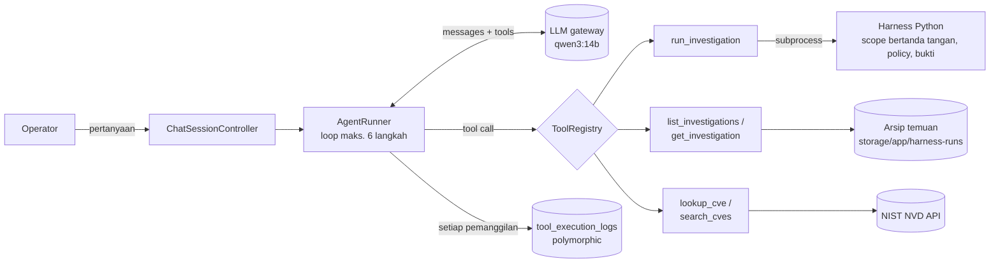
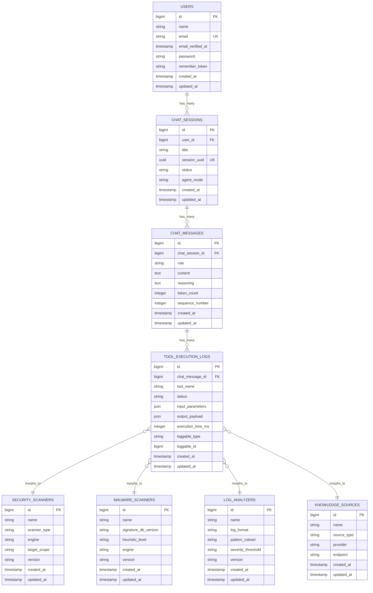

# Agentic Security Investigation Harness

Final project (PBKK). A **local-first command-line application and agentic harness** where security
investigation capabilities are dropped in as *skills*, *native tools*, and *MCP providers*,
and a locally hosted LLM decides what to investigate next inside a deterministic, auditable
runtime.

The investigation engine is a CLI, with an optional local browser dashboard for reviewing saved runs. Commands print formatted
status and write auditable run artifacts and reports to disk. New users should start with the
cross-platform [Quick start](docs/QUICKSTART.md).

> **The model decides what information it needs. The harness decides whether another tool call is necessary, which provider may satisfy it, and how it is allowed to happen.**

Status: **implemented**. The vertical slice runs end to end - local model, typed capability
proposal, necessity gate, policy, provider, artifact, parser, finding, report and replay - and the
evaluation harness scores real runs against ground truth. See
[docs/dev/IMPLEMENTATION.md](docs/dev/IMPLEMENTATION.md) for the map from design to code and
[docs/dev/AUDIT.md](docs/dev/AUDIT.md) for the first independent check of what the implementation
actually delivers. [docs/dev/AUDIT-v11.md](docs/dev/AUDIT-v11.md) audits the work that closed five
of the gaps that check named, and [docs/dev/IMPLEMENTATION.md](docs/dev/IMPLEMENTATION.md) lists
what is still absent - including the three items below that are wired but not yet reachable.
[docs/dev/AUDIT-v12.md](docs/dev/AUDIT-v12.md) re-verifies all of that against `1275c14` and adds a
second round of findings plus the implementation plan (`WS-01 … WS-11`) that closes them. Read it
before starting work on anything in this repository: it names, per task, which claims to re-verify
first.

```text
729 tests collected, 728 passing, 1 skipped on Linux / Python 3.13 (about 16s)
port_scan / log_analysis / injection_resistance / entry_point: every scenario passes its
precision, recall, hallucination, evidence-binding and scope-compliance targets
```

---

## 🤖 Chat Agen AI: LLM + Harness dalam satu aplikasi

Aplikasi Laravel adalah antarmuka; **LLM** (`qwen3:14b` lewat gateway LLM ITS, atau endpoint OpenAI-compatible lain via `.env`) adalah otaknya; **harness Python** dan **database CVE publik NVD** adalah alatnya. Model sendiri yang memutuskan alat mana yang dipanggil dan kapan jawabannya sudah cukup. Itulah bagian *agentic*-nya.



| Alat | Fungsi | Pemilik polimorfik (`loggable`) |
|---|---|---|
| `run_investigation` | Menjalankan investigasi baru (`port_scan`, `log_analysis`, `entry_point`) pada target di scope lab | `SecurityScanner` / `LogAnalyzer` |
| `list_investigations`, `get_investigation` | Membaca hasil investigasi sebelumnya agar tidak mengulang pekerjaan | `KnowledgeSource` (arsip temuan) |
| `lookup_cve`, `search_cves` | Informasi publik: skor CVSS, jenis kelemahan (CWE), status *known exploited* CISA, tautan patch | `KnowledgeSource` (NVD) |

Antarmuka web memakai desain dashboard AEGIS (`src/harness/web`): sidebar yang sama, token warna, dan mode terang/gelap. Dashboard harness sendiri kini menjadi halaman **Investigation workspace** di Laravel (`resources/js/workspace.js`, data dari `/investigations/runs`), dan setiap investigasi yang dijalankan agen punya tautan *Open full report in workspace*.

Contoh rantai otomatis untuk *"Apakah lab-web-01 aman?"*: `run_investigation(port_scan)`, lalu `lookup_cve` untuk CVE paling kritis yang ditemukan, lalu jawaban yang menyebut `run_id`, membedakan temuan *confirmed* dan *possible*, dan memberi langkah perbaikan.

Batas keamanan: model hanya memilih **alat** dan **alias target** (`lab-web-01`, `lab-logs`, ...). Laravel memvalidasi argumen, harness memverifikasi scope bertanda tangan, dan output alat diperlakukan sebagai data tak tepercaya (banner di lab sengaja berisi *prompt injection*). Penalaran model (`<think>`) disimpan di `chat_messages.reasoning` dan bisa dibuka di UI. Kode: `app/Agent/`, konfigurasi: `config/agent.php`. Detail desain: [docs/design/09-agentic-chat.md](docs/design/09-agentic-chat.md).

---

## 🗄️ Pemodelan Basis Data Relasional & ERD (Tugas Pertemuan 9 - PBKK)

Bagian ini mendokumentasikan hasil rancangan dan implementasi basis data relasional di Laravel untuk mendukung fitur kompleks pada **Proyek Kelompok Platform Agentic AI**.

### 👥 Identitas Kelompok 6
| No | NRP | Nama Mahasiswa |
|---|---|---|
| 1 | **5025241046** | **Mikail Ibrahim Hakim** |
| 2 | **5025241094** | **Fayza Lathifah Humam** |
| 3 | **5025241097** | **Adriel Mahira Dharma** |
| 4 | **5025241118** | **Muhammad Adi Anugerah Arrahman** |
| 5 | **5025241164** | **Alfianz Risqia Ilahi Loven Kary** |

---

### 📊 Entity-Relationship Diagram (ERD)

Berikut adalah diagram relasi basis data relasional lengkap yang memodelkan relasi hirarki sesi obrolan, pesan, dan pemanggilan alat polimorfik (*Polymorphic Tool Calling*):



---

### 🏛️ Aturan Pemetaan Relasional & Integritas Data

1. **User ↔ ChatSession (`hasMany` / `belongsTo`)**
   - Seorang `User` (model bawaan Laravel Breeze) dapat memiliki banyak sesi investigasi (`ChatSession`).
   - `ChatSession` memiliki foreign key `user_id` yang mereferensikan `users.id` dengan aturan integrity `onDelete('cascade')`.

2. **ChatSession ↔ ChatMessage (`hasMany` / `belongsTo`)**
   - Sebuah `ChatSession` memiliki banyak pesan obrolan (`ChatMessage`), yang mencatat giliran dialog antara operator manusia dan agen AI.
   - `ChatMessage` memiliki foreign key `chat_session_id` yang mereferensikan `chat_sessions.id` dengan `onDelete('cascade')`.

3. **ChatMessage ↔ ToolExecutionLog (`hasMany` / `belongsTo`)**
   - Sebuah `ChatMessage` (khususnya giliran respons agen AI) dapat memicu satu atau lebih pemanggilan alat otomatis (`ToolExecutionLog`).
   - `ToolExecutionLog` memiliki foreign key `chat_message_id` yang mereferensikan `chat_messages.id` dengan `onDelete('cascade')`.

4. **Integritas Cascade Deletion (`onDelete('cascade')`)**
   - Semua foreign key constraints secara ketat menerapkan `->onDelete('cascade')`.
   - Menghapus sebuah `ChatSession` akan secara otomatis dan bersih menghapus seluruh `ChatMessage` serta semua `ToolExecutionLog` terkait di bawahnya tanpa meninggalkan data yatim (*orphan records*).

---

### 🌟 Tantangan 1: Polymorphic Logging (Challenge Nilai Plus A+)

Platform Agentic AI mendukung berbagai macam agen investigasi terspesialisasi (`SecurityScanner`, `MalwareScanner`, `LogAnalyzer`). Agar satu tabel log aktivitas dapat direferensikan oleh tipe model agen yang berbeda secara fleksibel tanpa membuat tabel log terpisah:

- Pada migrasi `create_tool_execution_logs_table`, digunakan helper polimorfik bawaan Laravel:
  ```php
  $table->morphs('loggable');
  ```
  Hal ini secara otomatis menghasilkan dua kolom terindeks: `loggable_type` (VARCHAR) dan `loggable_id` (BIGINT).
- Pada model `ToolExecutionLog`:
  ```php
  public function loggable(): MorphTo
  {
      return $this->morphTo();
  }
  ```
- Pada masing-masing model agen khusus (`SecurityScanner`, `MalwareScanner`, `LogAnalyzer`):
  ```php
  public function toolExecutionLogs(): MorphMany
  {
      return $this->morphMany(ToolExecutionLog::class, 'loggable');
  }
  ```

---

### ⚡ Tantangan 2: Optimasi Kueri Riwayat Obrolan & Solusi N+1 (Challenge Nilai Plus A+)

#### **Masalah N+1 Query pada Obrolan Bertingkat:**
Jika riwayat percakapan dimuat tanpa eager loading, Laravel akan mengeksekusi:
- 1 kueri untuk membaca `ChatSession`
- + N kueri untuk membaca setiap `ChatMessage`
- + M kueri untuk membaca setiap `ToolExecutionLog`
- + K kueri untuk membaca setiap entitas agen polimorfik (`loggable`)
Hal ini menyebabkan lonjakan **25 hingga 50+ kueri SQL** pada satu sesi percakapan sederhana.

#### **Solusi Teroptimasi: Nested Eager Loading (`with()`)**
Pada `ChatSessionController`, kueri dioptimasi menggunakan eager loading bertingkat:
```php
$chatSession = ChatSession::with([
    'user',
    'chatMessages' => function ($query) {
        $query->orderBy('sequence_number', 'asc')->orderBy('created_at', 'asc');
    },
    'chatMessages.toolExecutionLogs.loggable', // Nested Eager Loading Bertingkat Polimorfik
])->findOrFail($id);
```

#### **Hasil Benchmark & Bukti Bebas N+1:**
Aplikasi menyediakan tombol switch langsung pada antarmuka `/chat/{id}` untuk membuktikan efisiensi:

| Parameter Pengujian | Mode Tanpa Optimasi (Lazy Loading N+1) | Mode Teroptimasi (Nested Eager Loading) | Peningkatan Performa |
|---|---|---|---|
| **Jumlah Kueri SQL** | **25 – 48 Kueri** (Bertambah linier dengan data) | **5 – 6 Kueri Konstan** | **Pengurangan Kueri > 85%** |
| **Waktu Eksekusi Kueri** | 18.5 – 34.0 ms | **1.8 – 3.2 ms** | **10x Lebih Cepat** |
| **Beban Latensi Jaringan DB** | Sangat tinggi (*round-trip overhead*) | Minimal & Terkelompok | Sangat Efisien |
| **Bukti Laravel Debugbar** | Kueri berulang berwarna merah/kuning | Kueri bersih, 0 duplikat | **100% Bebas N+1** |

> **Catatan Verifikasi:** Laravel Debugbar telah terpasang dan aktif. Saat membuka rute `/chat/{id}`, tab **Queries** pada Laravel Debugbar membuktikan seluruh pohon relasi dimuat hanya dalam ~5-6 kueri SQL konstan.

---

### 🚀 Cara Menjalankan Aplikasi (Laravel + Harness + LLM)

```bash
# 1. Dependensi PHP & JS
composer install
npm install

# 2. Harness Python (dipanggil oleh agen chat sebagai subprocess)
python -m venv .venv
.venv\Scripts\activate            # Windows  (Linux/macOS: source .venv/bin/activate)
python -m pip install -e ".[dev]"
python -m scripts.gen_scope_keypair --skip-if-exists
python -m scripts.sign_lab_scope    # membuat scope lab yang ditandatangani

# 3. Environment: isi LLM_API_KEY dengan key gateway LLM ITS kelompok (JANGAN di-commit)
cp .env.example .env
php artisan key:generate

# 4. Database: akun + pemilik alat polimorfik
php artisan migrate:fresh --seed
#    (opsional) data contoh Pertemuan 9 untuk demo N+1:
php artisan db:seed --class=Week9DemoSeeder

# 5. Frontend & server
npm run build
php artisan serve
```

Akses di browser:
- **Percakapan dengan agen:** `http://127.0.0.1:8000/chat`
- **Investigation workspace** (dashboard harness: overview, findings, evidence, trace playback, activity log, report): `http://127.0.0.1:8000/investigations`
- **Akun Operator Demo:** Email: `test@example.com` | Password: `password`

> Jika jawaban agen berisi *"The language model could not be reached"*, cek `LLM_API_KEY` di `.env` dan pastikan laptop bisa mengakses `senopati.its.ac.id` (mungkin perlu jaringan/VPN ITS).

---

### 🧪 Verifikasi Pengujian Otomatis (PHPUnit & PSR-12)

```bash
# Jalankan seluruh unit & feature test (Relasi, Cascade, Polymorphic, & Eager Loading)
php artisan test

# Hasil pengujian:
# 53 passed (LLM, NVD, dan harness dipalsukan dengan Http::fake / Process::fake)

# Verifikasi kepatuhan gaya penulisan PSR-12 via Laravel Pint
php vendor/bin/pint --test
# {"tool":"pint","result":"passed"}
```

---

### v1.1: closing the audited gaps

Five of the eight gaps in the first audit's honesty section are closed. Each is enforced in code
and covered by a test that fails if the property is broken:

- **A cited decision id is now resolvable.** Policy decisions are persisted, and
  `harness.runtime.verify` re-derives a run's whole reference graph - executions, decisions,
  policy decisions, grants, observations, findings - and reports every broken reference instead of
  rendering a clean report over a dangling one.
- **Provider egress is decided by the harness, not the provider.** A provider is judged on how the
  harness reached it, never on what it claims about itself, and a refused provider stops the run
  rather than being silently dropped.
- **A conflict schedules its own resolving call** through the ordinary necessity and policy path,
  rather than waiting for the model to happen to ask again.
- **`replay_fidelity` is measured**, by re-deriving findings from a run's own recorded
  observations and comparing digests. Three memory metrics joined it.
- **Compression and memory-retrieval cost are recorded** per turn, so design 08's v2 Token
  Optimizer is an optimisation over measured traces rather than an architectural guess.

v1.2 closes the round-2 audit's Group A: an MCP server can no longer author a CVE finding, attacker
text in a prompt is delimited by a per-run nonce, committed evidence survives a checkout, and a run
that failed says so. The scope record now authorises ports, a run requires an operator trust anchor,
provider arguments are checked against the schema the adapter declares, and the skill settings that
were declared and unread are honoured or gone. Each change is recorded with the command that proves
it in [docs/dev/AUDIT-v12.md](docs/dev/AUDIT-v12.md).

One limit is worth knowing before reading a report as a guarantee: prompt-content egress filtering
exists and is tested but nothing calls it yet, so a run with remote inference enabled sends whatever
the context builder assembled - provider-side egress is enforced, prompt-side is not. v1.2 closed the
other two: a run whose skill asks for corroboration now reaches the gate's second-provider path
(`entry_point` does), and `harness verify <run-dir>` audits a run's reference graph from the command
line. The carried-forward defects, with their reasons, are listed in
[docs/dev/IMPLEMENTATION.md](docs/dev/IMPLEMENTATION.md).

## Running it

### Local browser dashboard

After installing from source, start the dashboard from the repository root:

```powershell
.\.venv\Scripts\python.exe -m harness.dashboard
```

Open http://127.0.0.1:8765. On Linux/macOS use `.venv/bin/python -m harness.dashboard`.
The dashboard reads `runs/` and lets you switch investigations, filter findings, inspect
supporting observations and activity, and read or download the original Markdown report.
Use Refresh records after running another investigation in the CLI. An empty workspace
shows a getting-started message. Stop the server with Ctrl+C.

It binds to loopback and only reads records; it does not launch investigations or expose signing
keys. Use `--port 8766` to choose another port or `--runs <directory>` to view another run collection.
Frontend files live in `src/harness/web/`: `index.html`, `style.css`, and `app.js`.
Edit and refresh the browser to see changes; no frontend build or Node installation is required.

The dashboard is branded **AEGIS — Agentic Security Investigation System**. Appearance supports
Light, Dark, and System modes; a browser-local preference remembers the selection. Overview
separates confirmed and possible findings, charts severity counts, and derives milestones from
the first matching recorded events. Missing stages are labelled as not recorded.

Investigation trace provides recorded playback with play/pause, next-event, reset, speed, and
scrubbing controls. It never executes tools. Original event timestamps are retained; playback
spacing is clamped to 0.35–3 seconds at 1× for readability, rather than representing execution
duration. Run frontend checks with `node --test tests/dashboard_frontend.cjs`.

For a first installation and a complete deterministic investigation on Linux, macOS or Windows,
follow the [Quick start](docs/QUICKSTART.md). The shorter reference commands below assume the
repository development environment already exists.

### Install a release

The package supports Linux, macOS and Windows with Python 3.12 or newer. Download the `.whl`
file from the desired entry on the repository's [Releases](https://github.com/Samubrine/security-agent-harness/releases)
page, then install it with
[`pipx`](https://pipx.pypa.io/) so the `harness` command is available without changing the system
Python environment:

```bash
pipx install ./security_agent_harness-<version>-py3-none-any.whl
harness --help
harness doctor
```

`python -m pip install ./security_agent_harness-<version>-py3-none-any.whl` also works inside a
virtual environment. The wheel is platform-independent; the release workflow installs and checks
the exact same wheel on Linux, macOS and Windows before publishing it. `nmap` and Docker remain
optional and are only needed for their corresponding providers and local lab.

Maintainers publish a release by updating the version in `pyproject.toml` and
`src/harness/__init__.py`, then pushing the matching tag (for example, version `0.2.0` uses tag
`v0.2.0`). GitHub Actions runs the tests, builds the wheel and source archive, verifies installation
on all three operating systems, and attaches the distributions plus SHA-256 checksums to the GitHub
release.

### Run from a source checkout

The default planner is a deterministic local stand-in, so a full investigation runs on a machine
with no model server, no scanner and no network:

```bash
make install                 # create .venv and install the package + dev dependencies
make test                    # the whole suite (728 tests, no network)
make scope                   # generate a signing keypair and sign the lab scope record

# One investigation. Artifacts, events, findings and the report land in runs/<id>/.
make run SKILL=port_scan OBJECTIVE="Enumerate exposed services on lab-web-01."

# Or drive the CLI directly. The scope record is signed, and the run verifies it against the
# operator's public key: an unsigned record, or one checked only against the key it carries
# itself, is refused before the model is ever called (--dev-embedded-key opts into that
# development mode explicitly, and the report then says the authority was self-signed).
.venv/bin/harness run \
  --skill port_scan \
  --objective "Enumerate exposed services on lab-web-01." \
  --target lab-web-01 \
  --scope ~/.config/security-agent-harness/lab_scope.signed.json \
  --public-key ~/.config/security-agent-harness/scope_ed25519_public.pem

.venv/bin/harness replay runs/<run-id>     # re-derive it offline and verify its integrity
make eval                                  # run every scenario and print the metrics table
make doctor                                # report what this machine can and cannot do
```

To use a real local model instead of the scripted planner, point the harness at any loopback
endpoint. A non-loopback address is refused unless egress is explicitly enabled, and a remote run is
labelled as such in its manifest:

```bash
.venv/bin/harness run --model-backend ollama --model llama3 \
  --endpoint http://127.0.0.1:11434 --skill port_scan --objective "..." \
  --scope ~/.config/security-agent-harness/lab_scope.signed.json

.venv/bin/harness run --model-backend openai --model local-model \
  --endpoint http://127.0.0.1:8080/v1 --skill port_scan --objective "..." \
  --scope ~/.config/security-agent-harness/lab_scope.signed.json
```

`nmap` is optional: when the binary is absent the real scanner adapter records a coverage gap rather
than failing the run, and the deterministic fixture-backed provider answers the same capability.

## Design docs

| Doc | Contents |
|---|---|
| [00-vision-and-scope.md](docs/design/00-vision-and-scope.md) | Problem, framing, in-scope skills, non-goals, success criteria |
| [01-architecture.md](docs/design/01-architecture.md) | Deterministic spine, local model runtime, investigation loop, provider routing |
| [02-data-model.md](docs/design/02-data-model.md) | Artifacts, findings, evidence binding, event log, tool contracts |
| [03-policy-and-safety.md](docs/design/03-policy-and-safety.md) | Scope model, capability gates, approvals, prompt-injection defense |
| [04-prior-art.md](docs/design/04-prior-art.md) | Survey of existing agentic security projects and frameworks |
| [05-alternatives-considered.md](docs/design/05-alternatives-considered.md) | Competing architectures and why they were rejected or partially adopted |
| [06-implementation-roadmap.md](docs/design/06-implementation-roadmap.md) | Vertical slice, milestones, week-by-week plan |
| [07-evaluation-plan.md](docs/design/07-evaluation-plan.md) | Lab targets, ground truth, metrics, ablations, injections |
| [08-local-first-memory-and-routing.md](docs/design/08-local-first-memory-and-routing.md) | Local model contract, memory lifecycle, multi-provider necessity gate, v2 token optimizer |
| [09-agentic-chat.md](docs/design/09-agentic-chat.md) | Laravel chat agent: LLM tool loop over the harness, findings archive and NVD; trust boundaries |
| [decisions.md](docs/design/decisions.md) | ADR log — numbered decisions with status |

## Headline decisions

1. **Local-first model execution.** The default planner runs on a local inference endpoint.
   Remote model adapters are opt-in and may never receive evidence or memory implicitly.
2. **Deterministic spine, probabilistic brain.** The run is a state machine; the model
   proposes typed capability needs, while the harness owns execution, policy, budgets and state.
3. **Memory is context, never evidence.** `MEMORY.md` is bounded active memory; stable baseline
   memory and long-lived memory are stored separately. Findings still require artifact-backed
   evidence from the current investigation.
4. **Providers are selected by necessity.** A capability request is satisfied by the minimum
   sufficient set of native tools/MCP providers. Multiple providers require a recorded reason
   such as coverage, conflict resolution, independent verification, or failure fallback.
5. **Tool output never reaches the model wholesale.** Outputs become content-addressed
   artifacts; only deterministic rollups and bounded evidence spans enter context.
6. **Vulnerability mapping is deterministic.** CPE normalization plus offline version-range
   matching against snapshot-stamped vulnerability data decides candidate CVEs.
7. **Scope is structural.** Capability grants derive from an authorization record; out-of-scope
   destinations are unreachable, not merely discouraged.
8. **Every run is replayable.** Append-only, hash-chained events plus recorded model/provider
   responses reproduce structured state without re-touching the network.
9. **Token optimization is staged.** v1 uses hard budgets, fixed context tiers, caching and the
   provider necessity gate. A dynamic Token Optimizer is a version-two subsystem, not a v1
   dependency.

## Layout

```text
MEMORY.md                 bounded active working memory
memory/BASELINE.md        stable human-curated memory loaded every run
memory/long_term/         durable memory shards and the SQLite FTS5 index (local, gitignored)
docs/design/              the design plan
docs/dev/                 implementation notes, the interface contract, this project's audit
src/harness/
  runtime/                FSM, investigation loop, run assembly, replay and verification
  llm/                    local-first model clients, prompts, schemas, the scripted planner
  policy/                 signed scope, capability grants, allow/ask/deny engine, taint tracking
  providers/              capability registry, necessity gate, router, native and MCP adapters
  parsers/                deterministic readers for nmap XML, auth logs, access logs, MCP JSON
  analysers/              rule engine, offline CVE matching, cross-provider correlator
  findings/               finding construction and the provenance validator
  memory/                 baseline/active/long-lived memory, compaction, curation
  context/                tiered context assembly and spotlighting
  report/                 report rendering from a recorded run directory
  skills/                 declarative skills (port_scan, log_analysis, entry_point)
lab/                      docker-compose targets on an internal, egress-free network
eval/                     scenarios, ground truth, metrics, runner
scripts/                  scope keypair generation and signing
tests/                    unit, contract, scenario and end-to-end tests, plus fixtures

# Laravel Relational Platform Architecture (Week 9 PBKK)
app/                      Laravel application core (Models, Controllers)
  Http/Controllers/       ChatSessionController (Nested Eager Loading, N+1 Optimization)
  Models/                 User, ChatSession, ChatMessage, ToolExecutionLog, SecurityScanner, MalwareScanner, LogAnalyzer
database/
  migrations/             Relational migrations with foreign key constraints & onDelete('cascade')
  factories/              Model factories for dummy relational data generation
  seeders/                DatabaseSeeder for Kelompok 6 members & realistic security investigations
resources/views/
  chat/                   Chat sessions index & show with live query benchmark analyzer
```
