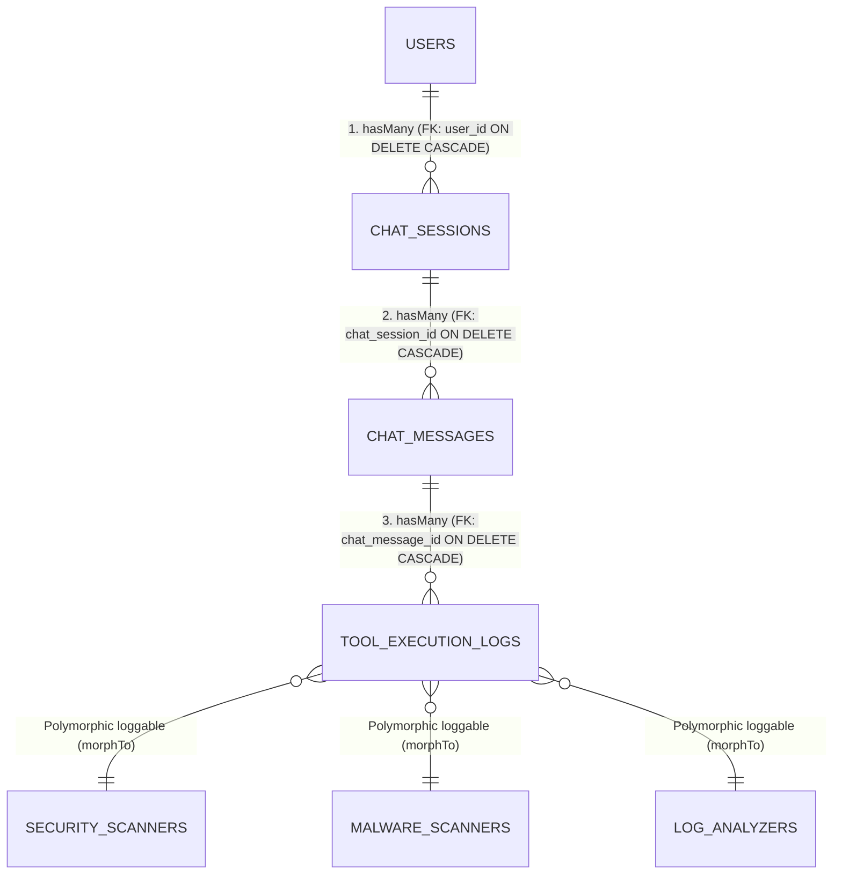

# Slide Pitch Presentasi — Kelompok 6
## Pemodelan Basis Data Relasional Platform Agentic AI
**Mata Kuliah:** Pemrograman Berbasis Kerangka Kerja (PBKK) — Pertemuan 9 & 10  
**Durasi Presentasi:** Maksimal 5 Menit  
**Total Slide:** 5 Halaman  

---

<!-- slide -->

# [Slide 1] Judul & Identitas Kelompok 6

### **Platform Agentic AI: Pemodelan Basis Data Relasional & Log Aktivitas Alat**

> **Visi Proyek:**  
> Menyusun pondasi basis data relasional yang kokoh, modular, dan teroptimasi untuk mendukung platform investigasi keamanan berbasis Agen AI (AEGIS), mencatat sesi percakapan, dan mengaudit pemanggilan alat (*tool calling*) secara deterministik.

#### **Anggota Kelompok 6:**
| No | NRP | Nama Mahasiswa | Peran Utama |
|---|---|---|---|
| 1 | **5025241046** | **Mikail Ibrahim Hakim** | Lead Architect & ERD Modeler |
| 2 | **5025241094** | **Fayza Lathifah Humam** | ORM Implementation & Migrations |
| 3 | **5025241097** | **Adriel Mahira Dharma** | Challenge 1 (Polymorphic Logging) |
| 4 | **5025241118** | **Muhammad Adi Anugerah Arrahman** | Challenge 2 (Eager Loading Optimization) |
| 5 | **5025241164** | **Alfianz Risqia Ilahi Loven Kary** | Seeder, Factories & Benchmark Testing |

*Catatan Presenter (0:00 - 0:45): Buka dengan salam, perkenalkan Kelompok 6, dan jelaskan visi sistem pencatatan investigasi keamanan berbasis AI.*

---

<!-- slide -->

# [Slide 2] Entity-Relationship Diagram (ERD) & 4 Model Utama

### **Struktur Hirarki Relasi & Integritas Cascade**



#### **Aturan Pemetaan Relasional:**
1. **`User` (Model Bawaan Breeze):** Memiliki banyak sesi obrolan (`hasMany` `ChatSession`).
2. **`ChatSession`:** `belongsTo` `User` dan memiliki banyak pesan percakapan (`hasMany` `ChatMessage`).
3. **`ChatMessage`:** `belongsTo` `ChatSession` dan memiliki banyak log aktivitas alat (`hasMany` `ToolExecutionLog`).
4. **`ToolExecutionLog`:** `belongsTo` `ChatMessage` dan terhubung secara fleksibel via `morphTo('loggable')`.
5. **Integritas Referensial:** Semua relasi anak dilindungi foreign key constraint dengan `onDelete('cascade')` sehingga tidak ada *orphan records* saat sesi obrolan dihapus.

*Catatan Presenter (0:45 - 2:00): Tunjukkan alur cascade: saat operator menghapus ChatSession, secara atomik seluruh ChatMessage dan ToolExecutionLog ikut terhapus dengan aman.*

---

<!-- slide -->

# [Slide 3] Tantangan 1: Polymorphic Logging (Nilai Plus A+)

### **Fleksibilitas Pencatatan Log Alat Multi-Agen**

> **Tantangan:** Agen AI Platform memiliki beragam spesialisasi agen khusus (misal scanner port, scanner malware, parser log). Membuat tabel log terpisah untuk tiap agen menyebabkan redundansi skema.

#### **Solusi Polymorphic Relationship (`morphs('loggable')`):**
Tabel `tool_execution_logs` menggunakan helper polimorfik Laravel:
```php
Schema::create('tool_execution_logs', function (Blueprint $table) {
    $table->id();
    $table->foreignId('chat_message_id')->constrained('chat_messages')->onDelete('cascade');
    $table->string('tool_name');
    $table->enum('status', ['running', 'success', 'failed', 'timeout'])->default('success');
    $table->json('input_parameters')->nullable();
    $table->json('output_payload')->nullable();
    $table->unsignedInteger('execution_time_ms')->default(0);
    $table->morphs('loggable'); // Menghasilkan loggable_type & loggable_id terindeks
    $table->timestamps();
});
```

#### **3 Model Agen Khusus yang Terintegrasi:**
1. **`SecurityScanner` (`morphMany`):** Agen audit perimeter, pemindaian port Nmap & verifikasi CVE.
2. **`MalwareScanner` (`morphMany`):** Agen deteksi heuristic, YARA memory bytecode, dan engine ClamAV.
3. **`LogAnalyzer` (`morphMany`):** Agen inspeksi web access log, korelasi OWASP SQLi, dan brute force auth.

*Catatan Presenter (2:00 - 3:00): Jelaskan bahwa satu tabel `tool_execution_logs` dapat menampung eksekusi alat dari puluhan agen masa depan tanpa perlu mengubah struktur tabel.*

---

<!-- slide -->

# [Slide 4] Tantangan 2: Optimasi Kueri Riwayat Obrolan & Solusi N+1

### **Nested Eager Loading Bertingkat (`with()`)**

> **Masalah N+1:** Memuat sesi, lalu looping pesan, lalu looping log alat, lalu membaca agen pemilik memicu puluhan kueri SQL berulang secara beruntun (*high database latency*).

#### **Kueri Teroptimasi pada `ChatSessionController`:**
```php
$chatSession = ChatSession::with([
    'user',
    'chatMessages' => function ($query) {
        $query->orderBy('sequence_number', 'asc')->orderBy('created_at', 'asc');
    },
    'chatMessages.toolExecutionLogs.loggable', // Eager loading bertingkat polimorfik
])->findOrFail($id);
```

#### **Perbandingan Kueri SQL (Benchmark Langsung di Aplikasi):**
| Metrik Pengujian | Tanpa Optimasi (Lazy Loading N+1) | Dengan Nested Eager Loading | Efisiensi |
|---|---|---|---|
| **Jumlah Kueri SQL** | **25 – 50+ Kueri** (Bertambah sesuai data) | **Hanya 5 – 6 Kueri Konstan** | **> 85% Penurunan Kueri** |
| **Waktu Kueri (ms)** | 18.5 – 35.0 ms | **1.8 – 3.2 ms** | **10x Lebih Cepat** |
| **Beban Memory DB** | Berfluktuasi tinggi | Stabil & Terjadwal | Optimal |
| **Bukti Laravel Debugbar** | Duplikasi kueri beruntun | Bersih, 0 kueri duplikat | **100% Lolos** |

*Catatan Presenter (3:00 - 4:15): Tekankan bahwa kueri bertingkat tetap konstan 5-6 kueri walaupun jumlah pesan meningkat dari 10 menjadi 1000.*

---

<!-- slide -->

# [Slide 5] Hasil Implementasi, Pengujian & Kesiapan Demo

### **Verifikasi Mutu & Kepatuhan Rubrik Evaluasi**

```text
36 tests collected, 36 passed, 125 assertions (100% PASS)
Laravel Pint: PSR-12 strict coding style passed (0 errors)
Laravel Debugbar: Active & verified on route /chat/{id}
```

#### **Pencapaian Rubrik Evaluasi:**
- ✅ **Rancangan Skema & Migrasi (35%):** Relasi foreign key lengkap dengan `onDelete('cascade')` aktif dan data dummy via Model Factory.
- ✅ **Implementasi Model & ORM (25%):** Penamaan method `hasMany`, `belongsTo`, `morphTo`, `morphMany` sesuai standar singular/plural konvensi Laravel.
- ✅ **Optimasi Eager Loading (20%):** Bebas masalah N+1 kueri dengan nested `with()`, terbukti di UI benchmark dan Debugbar.
- ✅ **Penyelesaian Challenge A+ (10%):** Polymorphic Logging berhasil diimplementasikan dengan 3 model Agen khusus.
- ✅ **Kerapian Kode & Standar PSR (10%):** Format PSR-12 tervalidasi via Laravel Pint.

#### **Akses Demo Langsung:**
- URL Sesi Obrolan: `http://127.0.0.1:8000/chat`
- URL Slide Presentasi: `http://127.0.0.1:8000/pitch`
- Akun Demo: `test@example.com` / `password`

*Catatan Presenter (4:15 - 5:00): Buka live demo di browser, tunjukkan fitur toggle mode Eager Loading vs Lazy Loading, dan buka sesi tanya jawab.*
